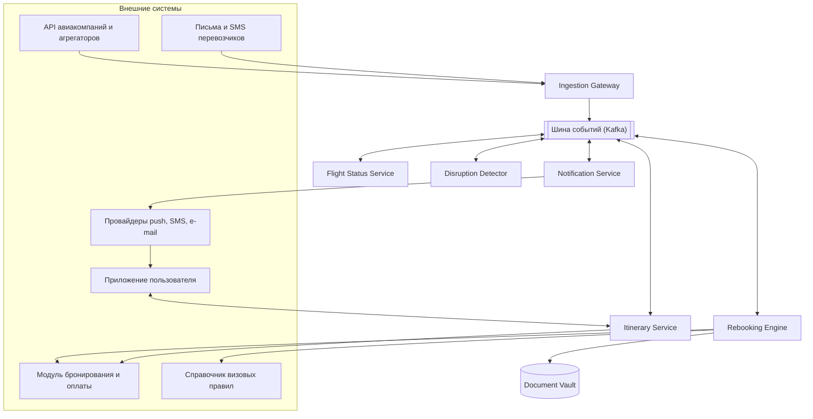
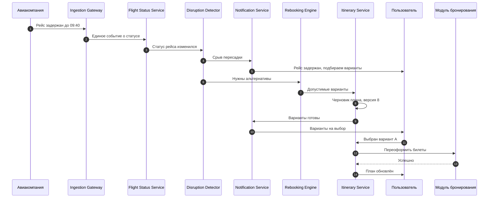
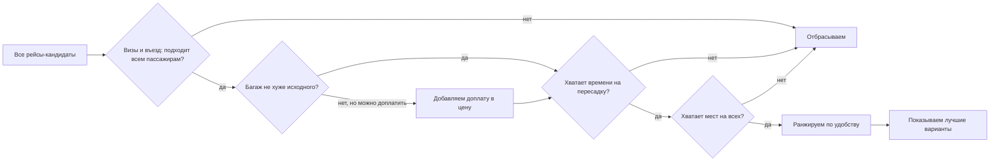
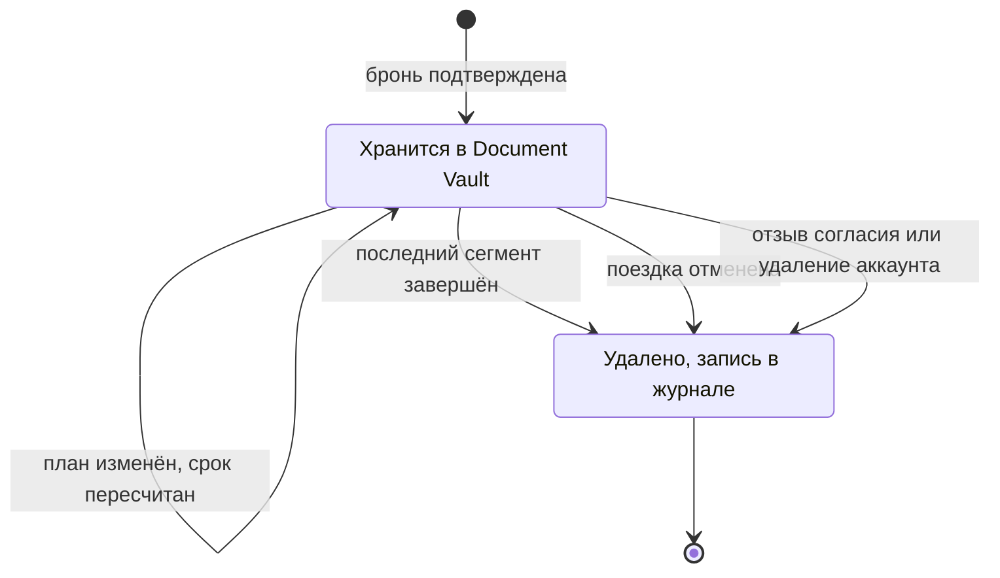
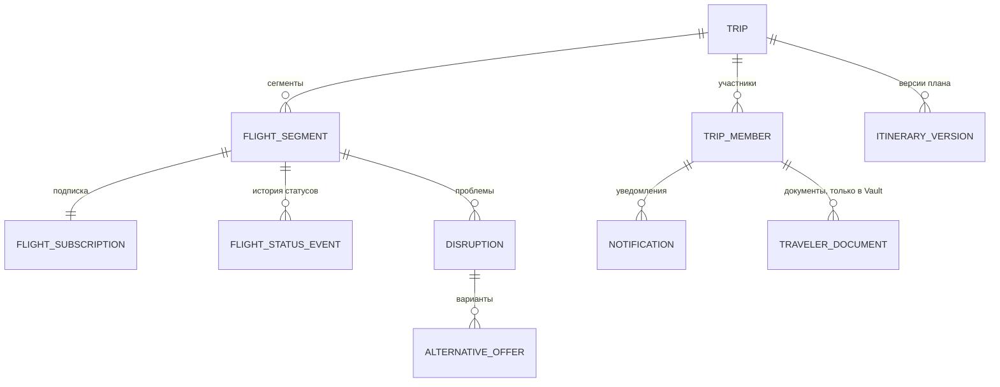

# Flight Watch: система, которая следит за рейсами и сама перестраивает поездку

Решение кейса 1 «Альфред, друг Бэтмена» (TravelTech). Системный анализ: требования, архитектура, потоки данных, модель данных, интеграции и граничные случаи.
По всему тексту проходит один сквозной пример (раздел 2), поэтому разные части решения легко связать между собой. Все рейсы, время и цифры в примерах условные.

## Содержание

1. [О чём речь](#1-о-чём-речь)
2. [Сквозной пример](#2-сквозной-пример)
3. [Что требует кейс и где это закрыто](#3-что-требует-кейс-и-где-это-закрыто)
4. [Допущения и границы](#4-допущения-и-границы)
5. [Требования](#5-требования)
6. [Архитектура](#6-архитектура)
7. [Как это работает шаг за шагом](#7-как-это-работает-шаг-за-шагом)
8. [Данные приходят с задержкой](#8-данные-приходят-с-задержкой)
9. [Пользователь может быть оффлайн](#9-пользователь-может-быть-оффлайн)
10. [Внешние API могут отказать](#10-внешние-api-могут-отказать)
11. [Подбор альтернатив: багаж, визы, таймзоны](#11-подбор-альтернатив-багаж-визы-таймзоны)
12. [Общий план поездки и конфликты расписаний](#12-общий-план-поездки-и-конфликты-расписаний)
13. [Групповые поездки](#13-групповые-поездки)
14. [Паспортные данные](#14-паспортные-данные)
15. [Платежи](#15-платежи)
16. [Персонализация без утечки данных](#16-персонализация-без-утечки-данных)
17. [Обратная связь по поездке](#17-обратная-связь-по-поездке)
18. [Модель данных](#18-модель-данных)
19. [Интеграции и API](#19-интеграции-и-api)
20. [Международные форматы данных](#20-международные-форматы-данных)
21. [Граничные случаи](#21-граничные-случаи)
22. [Метрики и приёмка](#22-метрики-и-приёмка)
23. [Что осталось за рамками](#23-что-осталось-за-рамками)
24. [Словарик](#24-словарик)

---

## 1. О чём речь

Представьте: вы летите с семьёй в отпуск. В приложении TravelTech уже куплены билеты, оплачен отель, заказан трансфер из аэропорта. Утром в день вылета ваш первый рейс задерживают почти на три часа, и на пересадку вы больше не успеваете. Обычно об этом узнают уже в аэропорту, с табло. А отель не знает, что вы приедете позже, и трансфер ждёт вас в то время, когда вы ещё в воздухе.

**Flight Watch** нужен, чтобы такого не случалось. Система сама:

1. следит за рейсами всех пользователей;
2. сообщает, как только с рейсом что-то случилось;
3. находит замену: другой рейс или, если ждать долго, чем занять время;
4. аккуратно перестраивает общий план поездки: трансфер, отель, активности.

Четыре принципа, на которых держится решение:

- **Ничего не покупается без подтверждения.** Система готовит варианты и черновик плана, а решает человек.
- **Уведомление не должно потеряться.** Если человек не в сети, оно дождётся его или придёт другим каналом.
- **Недопустимый вариант не показывается.** Если по визе, багажу или времени вариант не подходит хотя бы одному пассажиру, его нет в списке.
- **Паспортные данные живут ровно столько, сколько необходимо для поездки**, и не дольше.

---

## 2. Сквозной пример

Все примеры дальше про одну семью. Рейсы, время и цифры условные.

**Кто летит:** Анна (организатор поездки), Борис и дочь Маша, 6 лет, своего телефона у неё нет. У Бориса паспорт другой страны, в отличие от Анны и Маши, поэтому условия въезда и транзита у них могут отличаться.

**Маршрут:** Москва, Стамбул, Лиссабон, в декабре.

| Рейс | Вылет | Прилёт |
| --- | --- | --- |
| XX101 Москва (SVO) → Стамбул (IST) | 07:00 | 10:10 (оба города в часовом поясе UTC+3) |
| XX202 Стамбул (IST) → Лиссабон (LIS) | 12:30 | 14:00 (Лиссабон зимой в UTC+0) |

**Пересадка:** по плану 2 часа 20 минут, минимально допустимая — 60 минут (условное значение, в жизни его задаёт аэропорт).

**Багаж:** по одному чемодану на человека, зарегистрирован до Лиссабона сквозным билетом, то есть в Стамбуле его забирать не нужно.

**Что ждёт в Лиссабоне:** трансфер встречает в 14:30, заселение в отель с 15:00, обед в ресторане в 15:30 (забронирован через приложение).

**Что случится:** в 06:10 в день вылета авиакомпания сообщает, что XX101 вылетит не в 07:00, а в 09:40. Прилёт в Стамбул сдвигается на 12:50, и на рейс XX202 (12:30) семья уже не успевает. Дальше мы будем возвращаться к этой истории в каждом разделе.

---

## 3. Что требует кейс и где это закрыто

Таблица для быстрой проверки: каждая строчка условий кейса и раздел, в котором она решена.

| Условие кейса | Где разобрано |
| --- | --- |
| Отслеживать статус рейсов через внешние API или рассылки | разделы 6, 7, 8 |
| При задержке или отмене уведомлять пользователя | разделы 7, 9 |
| Автоматически предлагать альтернативные рейсы или активности | раздел 11 |
| Обновлять общий план путешествия | раздел 12 |
| Данные о рейсах приходят с задержкой | раздел 8 |
| Пользователь может быть оффлайн | раздел 9 |
| Альтернативы учитывают багаж, визы и таймзоны | разделы 11, 20 |
| Нельзя хранить паспортные данные дольше, чем нужно для поездки | раздел 14 |
| Поиск и бронирование билетов и отелей | граница решения в разделе 4, оплата в разделе 15 |
| Планирование маршрута | раздел 12 |
| Синхронизация расписаний и уведомлений | разделы 9, 12 |
| Персонализированные рекомендации | раздел 16 |
| Уведомления о задержках и изменениях | разделы 7, 9 |
| Обратная связь по поездке | раздел 17 |
| Многопользовательский режим (семья, группа) | раздел 13 |
| Интеграции с внешними API | разделы 10, 19 |
| Обработка платежей и паспортных данных | разделы 14, 15 |
| Тайм-зоны и международные форматы данных | разделы 11, 20 |
| Конфликты расписаний и пересадок | разделы 11, 12 |
| Персонализация без утечки данных | раздел 16 |
| Надёжность при отказах внешних API | раздел 10 |

---

## 4. Допущения и границы

Мы проектируем не весь TravelTech, а одну его часть, которая реагирует на изменения рейсов. Всё остальное (поиск, покупка, оплата) уже существует, и мы с ним договариваемся о понятных точках стыка.

- **Единица отслеживания - сегмент рейса** (один перелёт из точки A в точку B). Поездка состоит из нескольких сегментов.
- **Источники статусов:** API авиакомпаний и агрегаторов (они сами присылают изменения или мы их периодически опрашиваем), а также письма и SMS от перевозчиков как резервный канал.
- **Поиск, покупку, обмен и оплату выполняет существующий модуль бронирования.** Flight Watch просит его найти предложения и переоформить билеты, но сам билетами не торгует.
- **Покупка только по подтверждению пользователя.** Слово «автоматически» в задании мы понимаем как автоматический подбор и подготовку плана. Режим «принимать мелкие изменения без вопросов» возможен как отдельная настройка, но по умолчанию выключен (раздел 23).
- **Время** хранится в UTC вместе с названием таймзоны аэропорта, а пользователю показывается местное.
- **Пороги и сроки настраиваются, а не зашиты в код.** Это порог значимой задержки, минимальное время пересадки, срок жизни предложения. В примерах стоят условные значения.

---

## 5. Требования

Система должна пройти путь «рейс изменился → человек узнал → получил варианты → план обновился» и не ломаться, когда что-то идёт не так.

### Функциональные

1. **Подписка на рейс.** Когда бронь подтверждена, система сама начинает следить за каждым сегментом. Пользователь ничего не настраивает.
2. **Сбор статусов из нескольких источников** и приведение их к единому виду: плановое, расчётное и фактическое время, статус, терминал, гейт.
3. **Обнаружение значимых изменений:** задержка больше порога, отмена, смена аэропорта или терминала, срыв пересадки. Незначительные отклонения только записываются в историю.
4. **Уведомление всех участников поездки** по их каналам, с учётом того, что человек может быть не в сети.
5. **Подбор альтернативных рейсов**, а если ожидание долгое, то и подбор активностей на свободное время.
6. **Пересчёт общего плана:** затронутые бронирования (трансфер, отель, активности) помечаются, и по ним предлагаются изменения.
7. **Применение выбора пользователя** с откатом, если переоформление не удалось.
8. **Сбор обратной связи** после решения проблемы и после поездки.

### Нефункциональные

| Требование | Что это значит на практике |
| --- | --- |
| Надёжность | Отказ одного источника не останавливает остальные. Данные не теряются. |
| Идемпотентность | Если одно и то же событие пришло дважды, пользователь получит одно уведомление, а не два. |
| Скорость | Уведомление уходит не позже 2 минут после получения события (стартовый ориентир, уточнить с бизнесом). |
| Безопасность | Паспортные данные шифруются, хранятся отдельно и удаляются по окончании поездки. |
| Масштабируемость | Массовая отмена в одном аэропорту даёт пик нагрузки. События обрабатываются асинхронно, рейс опрашивается один раз для всех, кто на него подписан. |
| Наблюдаемость | По номеру поездки видно весь путь события. Если обновления по рейсу перестали приходить, срабатывает алерт. |

---

## 6. Архитектура

Данные из внешнего мира входят в систему через одну «входную дверь». Дальше небольшие сервисы передают друг другу сообщения через общую «почту» (шину событий). Каждый занят своим делом: один хранит статусы, другой решает, что считать проблемой, третий ищет замену, четвёртый ведёт план, пятый рассылает уведомления.



| Компонент | Что делает | Пример из нашей истории |
| --- | --- | --- |
| **Ingestion Gateway** | Единственная входная дверь для данных о рейсах. Подключает каждый источник через свой адаптер, приводит сообщения к единому виду, убирает дубли. | Письмо авиакомпании и ответ агрегатора про один и тот же рейс превращаются в одинаковые по форме события. |
| **Flight Status Service** | Хранит текущее состояние рейса и историю изменений. Принимает новое событие, только если оно свежее текущего состояния. | Запоминает: XX101 вылетит в 09:40. |
| **Disruption Detector** | Сравнивает состояние рейса с планом поездки и решает, есть ли проблема. | Видит, что на рейс XX202 семья уже не успевает, и объявляет «срыв пересадки». |
| **Rebooking Engine** | Подбирает замену, отсекает недопустимое, ранжирует остальное. Подбирает и активности на свободное время. | Находит два рейса из Стамбула, один из них отбрасывает из-за визы Бориса. |
| **Itinerary Service** | Ведёт общий план поездки по версиям. Готовит черновик нового плана, помечает затронутые бронирования, применяет выбор пользователя. | Создаёт версию 8 плана: перелёт, трансфер, обед сдвинуты. |
| **Notification Service** | Отправляет уведомления, следит за доставкой, повторяет другим каналом. | Отправляет push Анне и Борису, а если не доставлен, то SMS. |
| **Document Vault** | Единственное место, где лежат паспортные данные. Отдаёт другим сервисам только ответы вроде «виза в порядке». | Подтверждает Rebooking Engine, что у Бориса нет нужной транзитной визы. |

Шина событий делает сервисы независимыми: если, например, уведомления на минуту «легли», событие подождёт в очереди и не пропадёт. А если нужно разобраться, что произошло, можно «перемотать» события и проиграть их заново.

---

## 7. Как это работает шаг за шагом



**Шаги:**

1. **Подписка.** Бронь подтверждена, и Itinerary Service создаёт подписку на рейс: какой сегмент, на какую дату, кто из пассажиров летит и как с ними связаться.
2. **Сбор.** Ingestion Gateway опрашивает API (чем ближе вылет, тем чаще), принимает сообщения от источников и разбирает письма. Каждое сообщение получает две отметки времени: когда событие произошло у источника и когда оно дошло до нас.
3. **Нормализация и дедупликация.** Сообщения приводятся к единому виду: время в UTC, коды аэропортов IATA, расчётное и фактическое время отдельно. Повтор определяется по ключу «рейс, дата, источник, версия сообщения».
4. **Обновление состояния.** Flight Status Service принимает событие, только если оно свежее того, что уже хранится, и публикует `FlightStatusChanged`.
5. **Детекция.** Disruption Detector сравнивает новое состояние с планом: задержка больше порога, отмена, смена аэропорта, пересадка с запасом меньше минимального. Результат — событие `DisruptionDetected` с типом, серьёзностью и затронутыми сегментами. Мелкие отклонения только записываются в историю.
6. **Первое уведомление, сразу.** Пользователь узнаёт о проблеме, не дожидаясь подбора вариантов.
7. **Подбор.** Rebooking Engine ищет замену и проверяет её по визам, багажу и таймзонам (раздел 11).
8. **Черновик плана.** Itinerary Service создаёт версию N+1 и помечает затронутые бронирования. Действующая версия N не меняется до подтверждения.
9. **Второе уведомление.** Пользователь получает варианты и срок, до которого они действительны.
10. **Применение.** Выбор уходит в модуль бронирования. Успех — версия N+1 становится действующей, трансфер и активности обновляются. Неудача — остаётся версия N, а пользователю предлагается следующий вариант.

**Та же история по времени** (время условное):

| Время | Что происходит |
| --- | --- |
| 06:10 | Авиакомпания сообщает: XX101 вылетит в 09:40 вместо 07:00. |
| 06:10 | Ingestion Gateway принимает сообщение и приводит к единому виду. Flight Status Service сохраняет новое состояние. |
| 06:11 | Disruption Detector считает: прилёт в Стамбул в 12:50, плюс 60 минут на пересадку — это 13:50, а XX202 вылетает в 12:30. Фиксирует «срыв пересадки», серьёзность высокая. |
| 06:11 | Анна и Борис получают push: «Рейс XX101 задерживается на 2 ч 40 мин, вы не успеваете на пересадку в Стамбуле. Подбираем варианты.» |
| 06:12 | Rebooking Engine ищет рейсы из Стамбула в Лиссабон на этот день и проверяет каждый для каждого пассажира. |
| 06:14 | Itinerary Service собирает черновик плана, версия 8 (действующая — 7). |
| 06:14 | Приходит второе уведомление: «Нашли 2 варианта. Предложение действует 30 минут.» (30 минут — настраиваемое значение). |
| 06:20 | Анна выбирает вариант А. |
| 06:21 | Модуль бронирования переоформляет билеты, версия 8 становится действующей. Трансфер и обед сдвинуты, Анна видит «План обновлён». |

---

## 8. Данные приходят с задержкой

То, что мы знаем о рейсе, всегда немного старше реальности. Авиакомпания обновляет статус не мгновенно, агрегатор показывает копию, письмо идёт минуты или часы. Поэтому система не может слепо верить порядку, в котором к ней приходят сообщения, и не должна ждать, пока рейс «официально» опоздает.

**Что делаем:**

1. **Храним два времени.** `source_event_time` - когда изменение произошло у источника. `received_at` - когда оно дошло до нас. Состояние рейса определяется по первому, а не по порядку прихода.
2. **Свежее побеждает.** Если более старое событие пришло позже более нового, оно записывается в историю, но состояние не меняет.
3. **Источники имеют приоритет.** Сначала сообщения от авиакомпании (webhook), потом опрос агрегаторов, потом письма. Письма самые медленные и менее надёжные, поэтому они не отменяют данные API.
4. **Если источники противоречат друг другу,** рейс получает статус «уточняется». Мы не объявляем отмену по одному сомнительному сообщению, но пользователя предупреждаем сразу.
5. **Честная пометка в уведомлении:** «по данным на 06:10». Человек понимает, что информация может устареть.
6. **Прогноз вместо ожидания факта.** Disruption Detector смотрит на расчётное время, а не ждёт фактического. Если расчётный прилёт уже не оставляет времени на пересадку, тревога поднимается сразу.
7. **Поправка на лаг.** Порог тревоги по пересадке берётся с запасом на типичную задержку данных у источника.
8. **Опрос чаще по мере приближения вылета.** За сутки достаточно изредка, за пару часов нужно часто. Конкретные интервалы настраиваются.

**Пример: сообщения пришли в неправильном порядке.**

| Источник | Время события у источника | Пришло к нам | Что говорит | Что делает система |
| --- | --- | --- | --- | --- |
| Авиакомпания | 06:10 | 06:10 | Задержка до 09:40 | Принимает: новое состояние |
| Агрегатор | 05:50 | 06:25 | Вылет по расписанию, 07:00 | Записывает в историю, состояние не меняет: событие старше текущего |

Если бы система ориентировалась на порядок прихода, то в 06:25 она «откатила» бы задержку и сказала семье, что всё хорошо.

---

## 9. Пользователь может быть оффлайн

Человек в тоннеле, в самолёте, без интернета за границей, телефон разряжен. Мы всё равно должны довести до него важную новость, а когда он вернётся в сеть, показать актуальный план без путаницы.

**Как не потерять уведомление:**

- Каждое уведомление сначала записывается в **Notification Inbox** со статусами «ожидает», «доставлено», «прочитано». Оно существует независимо от того, дошёл ли push.
- Доставка идёт **каскадом:** push, затем SMS, затем e-mail. Если доставка не подтверждена за заданное время, включается следующий канал.
- **Критичные события** (отмена, срыв пересадки, вылет в ближайшие часы) дублируются SMS сразу, не дожидаясь, пока push «не дойдёт».
- Дети и другие участники без телефона получают уведомления через взрослых участников поездки.

**Как вернуться в сеть без путаницы:**

- Приложение запрашивает не весь план, а только изменения после последней известной версии: `since_version`. Так синхронизация быстрая и не затирает локальные данные.
- Если человек сделал выбор, пока был оффлайн, приложение отправляет его **вместе с номером версии плана**, на которой выбор делался. Сервер проверяет, не изменился ли план за это время (оптимистичная блокировка). Если изменился, выбор не применяется молча, а пользователю показывается обновлённый план.
- **Предложения имеют срок жизни.** Если человек вернулся после его окончания, он видит свежий список вариантов, а не просроченный.

**Пример.** Анна едет в аэропорт на такси, и связь пропала в тоннеле. В 06:11 push ей не доставлен. Через заданное время Notification Service отправляет SMS, и как только телефон ловит сеть, Анна получает сообщение. Через несколько минут она открывает приложение, и оно забирает изменения плана после версии 7 и непрочитанные уведомления. Если за это время рейс изменился ещё раз, а Анна успела выбрать вариант по старому плану, сервер сравнит версии, увидит расхождение и покажет актуальные варианты.

---

## 10. Внешние API могут отказать

Внешние сервисы иногда тормозят, отвечают ошибками или пропадают на час. Система должна пережить это без паники и без потери данных, а пользователю честно сказать, что она знает, а что нет.

| Приём | Что это | Зачем |
| --- | --- | --- |
| **Таймауты** | Не ждём ответа бесконечно | Чтобы один медленный источник не повесил всю обработку |
| **Повторы с нарастающей паузой** | Повторяем запрос через 1, 2, 4... секунд, с небольшим случайным разбросом | Чтобы не «добивать» упавший сервис и не делать запросы синхронно со всеми остальными |
| **Circuit breaker** (предохранитель) | Если источник слишком часто отвечает ошибками, мы на время перестаём к нему обращаться | Как пробки в электрощитке: не жжём ресурсы и даём источнику восстановиться |
| **Резервный источник** | Если основной недоступен, берём данные из следующего по приоритету | Чтобы продолжать получать статусы |
| **Кэш с возрастом** | Храним последний известный статус и время его получения | Можно честно сказать «данные на 06:10», а не молчать |
| **Dead letter queue** | События, которые не удалось обработать, откладываются в отдельную очередь | Ничего не теряется, можно разобрать вручную или обработать повторно |
| **Heartbeat-алерт** | Если по рейсу в ближайшие 24 часа нет обновлений дольше допустимого, срабатывает тревога | Тишина тоже сигнал: источник может молчать из-за сбоя, а не потому, что всё спокойно |
| **Один опрос на рейс** | Если на рейс подписаны 50 человек, API опрашивается один раз, а результат раздаётся всем | Экономим лимиты внешнего API и ускоряем реакцию |

**Что видит пользователь в разных ситуациях:**

| Ситуация | Что видит пользователь |
| --- | --- |
| Источник статусов недоступен, но есть резервный | Ничего особенного, всё работает |
| Все источники недоступны | Последний известный статус с пометкой «данные на 06:10, обновляем» |
| Рейс изменился, но подобрать варианты не удалось | «Рейс изменился. Не получилось найти варианты автоматически, вот ссылка на ручной поиск.» Устаревшие цены как актуальные не показываются |
| Предложение истекло, пока человек выбирал | «Предложение устарело, вот обновлённые варианты» |

---

## 11. Подбор альтернатив: багаж, визы, таймзоны

Система не просто находит другие рейсы, а проверяет каждый из них для каждого пассажира по нескольким пунктам. Вариант, который не проходит хотя бы один из обязательных пунктов, пользователю не показывается. Оставшееся сортируется по удобству.



### Визы и въезд

Для каждого пассажира проверяем: гражданство, страну назначения и страны транзита, срок и кратность визы, срок действия паспорта на дату нового рейса. Отдельный вопрос — транзит: нужна ли транзитная виза и придётся ли выходить из международной зоны аэропорта.

**Пример.** По исходному плану чемоданы зарегистрированы сквозным билетом до Лиссабона, поэтому в Стамбуле никто никуда не выходит и вопросов с визой нет. Если же пересадить семью на рейс другой авиакомпании без сквозной регистрации, чемоданы придётся забрать и сдать заново, то есть выйти из транзитной зоны. Для Бориса это потребовало бы визы, которой у него нет. Значит, такой вариант недопустим для всей семьи.

Вариант недопустим для всей группы, если он недопустим хотя бы для одного пассажира. Разделить семью можно только отдельным осознанным пунктом, который организатор выбирает сам (раздел 13).

### Багаж

Проверяем, что норма багажа на новом рейсе не меньше исходной и есть ли сквозная регистрация у нового перевозчика. Если багаж придётся забирать и сдавать заново, это отражается в карточке варианта и учитывается в визовой проверке. Доплата за багаж входит в цену варианта, чтобы человек не узнал о ней в аэропорту.

### Таймзоны

Все расчёты внутри системы идут в UTC, а показываются местное время и название города.

**Пример.** Вариант А вылетает из Стамбула в 15:45 по местному времени (UTC+3), это 12:45 по UTC. Лететь четыре с половиной часа, значит, в Лиссабоне будет 17:15 UTC, то есть 17:15 по местному времени (UTC+0). Если смотреть только на часы в билете, кажется, что перелёт длится полтора часа. Расчёт в UTC исключает такие ошибки и правильно показывает «+1 день», если прилёт приходится на следующие сутки.

Дополнительно проверяем минимальное время пересадки с учётом смены терминала или аэропорта и пересчитываем всё, что зависит от нового времени прилёта: трансфер, заселение, выезд.

### Что получила семья в нашем примере

| | Вариант А | Вариант Б |
| --- | --- | --- |
| Рейс | XX204, Стамбул → Лиссабон | YY330, Стамбул → Лиссабон |
| Вылет и прилёт (местное время) | 15:45 → 17:15 | 14:10 → 15:40 |
| Авиакомпания | та же, багаж остаётся сквозным | другая, багаж нужно забрать и сдать заново |
| Визы | всем пассажирам подходит | Борису нужна виза, которой нет |
| Доплата | нет | нет |
| Итог | **показываем** | **отбрасываем** |

Вариант Б был бы быстрее, но пользователь его не увидит: на практике он привёл бы к тому, что Бориса не пустили бы в зону багажа.

### Ранжирование допустимых вариантов

Среди допустимых вариантов побеждает тот, что удобнее. Учитываются: общее время в пути, доплата, число пересадок, близость к исходному времени вылета, предпочтения из профиля (прямые рейсы, дневные вылеты и так далее) и **число затронутых других бронирований**: чем меньше трансферов, отелей и активностей придётся менять, тем лучше.

### Как выглядит карточка варианта

```json
{
  "offer_id": "offer-1042",
  "valid_until": "2026-12-01T03:44:00Z",
  "segments": [
    {"flight": "XX204", "from": "IST", "to": "LIS",
     "dep_local": "2026-12-01T15:45", "arr_local": "2026-12-01T17:15"}
  ],
  "extra_cost": {"amount_minor": 0, "currency": "EUR"},
  "baggage": {"same_as_original": true, "recheck_required": false},
  "entry_check": {"all_passengers_ok": true},
  "affected_bookings": ["transfer-17", "activity-5"]
}
```

### Активности на свободное время

Если ожидание в пункте пересадки или сдвиг поездки достаточно большие, Rebooking Engine предлагает занять время. Учитываются часы работы, время на дорогу и, что важно, то, **может ли пассажир покинуть аэропорт по своему визовому статусу.**

**Пример.** Ожидание в Стамбуле до 15:45 составляет около трёх часов. Анна и Маша могли бы выйти в город, но Борис не может, поэтому группе предлагаются только варианты в самой транзитной зоне (например, пообедать в кафе). Выход в город включается в варианты, только если он допустим для всех и остаётся запас времени вернуться к регистрации.

---

## 12. Общий план поездки и конфликты расписаний

У поездки есть один общий план: перелёты, трансферы, отель, активности. Когда меняется одно, остальное нужно подвинуть так, чтобы всё сошлось по времени. Система делает это сама, но предлагает человеку посмотреть и согласиться.

**План хранится версиями.**

- **Действующая версия** (например, 7) — то, что актуально сейчас.
- **Черновик** (версия 8) — то, что система предлагает после изменения рейса. Он не меняет действующий план, пока пользователь не подтвердит.
- **Заменённые версии** хранятся, чтобы можно было откатиться и разобраться, что менялось.

**Как система ищет конфликты.** После выбора варианта Itinerary Service проверяет все бронирования плана и находит те, что пересекаются по времени или перестали подходить:

- прилёт позже, чем начало трансфера;
- прилёт позже, чем начинается активность;
- заселение или выезд из отеля не стыкуются с новым временем прибытия;
- у участников группы получились разные расписания.

**Пример.** Было и стало после выбора варианта А:

| Бронирование | Было (версия 7) | Станет (версия 8) | Что делает система |
| --- | --- | --- | --- |
| Перелёт Стамбул → Лиссабон | XX202, 12:30 → 14:00 | XX204, 15:45 → 17:15 | Переоформляет билеты в модуле бронирования |
| Трансфер из аэропорта | 14:30 | 17:45 | Предлагает перенести одним действием |
| Заселение в отель | с 15:00 | с 15:00 | Остаётся, но отель получает предупреждение о позднем прибытии |
| Обед в ресторане | 15:30 | 15:30, не успеть | Помечает конфликт и предлагает перенести на другой день или отменить |

Если у партнёра (отеля, трансфера) есть интеграция, изменение предлагается применить одним нажатием. Если интеграции нет, система показывает, что именно нужно сделать, и даёт контакты.

**Синхронизация.** Клиент всегда забирает план по версии (`since_version`). Так в приложении у Анны, Бориса и на веб-версии одновременно показывается один и тот же актуальный план.

**Откат.** Если переоформление билетов не удалось, версия 8 не становится действующей, остаётся версия 7, а пользователю предлагается следующий вариант.

---

## 13. Групповые поездки

В поездке может быть несколько человек, и у каждого свои документы, визы и багаж. Система должна учесть это при подборе и не запутаться, когда решения принимает не один человек.

| Вопрос | Как решаем |
| --- | --- |
| Кто получает уведомления | Все взрослые участники по своим каналам. Дети получают через взрослых |
| Кто принимает решение | По умолчанию организатор поездки. Можно настроить «любой взрослый участник» |
| Что с визами и документами | Допустимость проверяется отдельно для каждого пассажира |
| Если вариант подходит не всем | Показываем только общие варианты. Разделение группы предлагаем отдельным явным пунктом |
| Если двое выбрали разное | Побеждает выбор, подтверждённый первым. Второй увидит обновлённый план (используется та же проверка версий, что и в оффлайне) |
| Что видят другие участники | Видят состав поездки и причины отказа без деталей документов, например «одному из пассажиров не хватает условий для въезда». Подробности видит сам пассажир и организатор |

Для Анны, Бориса и Маши вариант Б не проходит из-за визы Бориса. Анна как организатор видит это в списке причин, но номер паспорта Бориса ей не показывается. Вариант А подходит всем и предлагается как основной.

---

## 14. Паспортные данные

Паспорт нам нужен, чтобы проверять визы и оформлять билеты при замене. Как только поездка закончилась, он нам не нужен, поэтому мы его удаляем. Всё остальное устроено так, чтобы паспортные данные нигде не «растекались» по системе.



### Правила

- **Что храним.** Только поля, нужные для проверок и оформления билета: гражданство, номер, срок действия, ФИО как в паспорте. Сканы и фотографии паспорта мы не храним.
- **Где храним.** Только в Document Vault: шифрование на уровне полей, отдельные ключи в хранилище ключей, доступ только у сервисных ролей. В логи, аналитику и рекомендации эти данные не попадают.
- **Кто что видит.** Остальные сервисы получают не паспорт, а ссылку `document_ref` и готовые ответы вроде `visa_ok` и `passport_valid_on_date`.
- **Когда удаляем.** Поле `delete_after` равно времени завершения последнего сегмента поездки, без дополнительного буфера: для возврата или обмена паспорт не нужен, достаточно номера брони. Если юристы потребуют буфер, он задаётся одним параметром.
- **Когда рейс задержан,** срок хранения сдвигается вместе с ним: берётся более позднее из планового и расчётного времени прибытия последнего сегмента. Иначе можно было бы удалить данные, пока человек ещё в пути.
- **Если план продлил поездку,** срок пересчитывается от нового последнего сегмента.
- **Как удаляем.** Ежедневное фоновое задание удаляет просроченные записи. В журнал попадает факт удаления (кто, когда, по какой причине) без самих данных.
- **Сразу, без ожидания срока,** данные удаляются при отмене поездки, удалении аккаунта и отзыве согласия.
- **Что уходит наружу.** Перевозчику паспортные данные передаются только в момент оформления билета и в минимальном составе. В логах, событиях шины и аналитике их нет.
- **Резервные копии.** Из них записи исчезают по циклу ротации копий (срок ротации фиксируется в регламенте).
- **Сохранение «на будущее»** возможно только по явному согласию пользователя (opt-in) и с собственным сроком. По умолчанию такого режима нет.
- **Основание:** принципы минимизации данных и ограничения срока хранения, которые требуют и 152-ФЗ, и GDPR.

**Пример жизненного цикла.** Поездка семьи заканчивается прилётом в Лиссабон в 17:15. Поскольку рейс был заменён, система пересчитала `delete_after` на 17:15. Если бы рейс опоздал на час, срок сдвинулся бы на 18:15. После этого времени фоновое задание удаляет паспортные данные всех троих, а в журнале остаётся запись «данные удалены по окончании поездки» без самих данных.

---

## 15. Платежи

При замене рейса может понадобиться доплата. Деньги — самая чувствительная часть, поэтому здесь важны две вещи: не списать дважды и не оставить человека в состоянии «билет обменяли, а оплата не прошла».

- **Карточные данные мы не храним.** Платежи проходят через платёжного провайдера, а у нас остаётся только токен и результат операции. Требования к защите карточных данных остаются на стороне провайдера.
- **Идемпотентность.** Каждый запрос выбора содержит уникальный ключ `Idempotency-Key`. Если приложение отправило его дважды (из-за плохой связи), деньги спишутся один раз.
- **Последовательность, которую можно откатить:** сначала резервируем место на новом рейсе, потом проводим оплату, потом подтверждаем обмен. Если на каком-то шаге ошибка, предыдущие шаги отменяются, и пользователь остаётся с исходным билетом.
- **Оплата не прошла.** Вариант остаётся доступным до конца срока предложения, человек может выбрать другой способ оплаты или другой вариант.
- **Возврат разницы,** если новый рейс дешевле, идёт тем же путём, каким была оплата.

---

## 16. Персонализация без утечки данных

Система выбирает варианты и активности под интересы человека. Но для этого ей не нужно знать паспорт или платёжные данные, а другим участникам поездки не нужно знать чужие вкусы.

- **Рекомендации считает отдельный сервис,** которому недоступны паспортные и платёжные данные. Он видит только обезличенный профиль: псевдоним пользователя и категории интересов вроде «любит музеи», «предпочитает прямые рейсы».
- **В события для рекомендаций попадают только нужные поля.** Имена, документы и контакты в них не передаются. В логах такие данные не пишутся.
- **Человек управляет персонализацией.** Её можно ограничить или выключить, и всё продолжит работать, просто с менее точным ранжированием.
- **В группе предпочтения не раскрываются.** Если Анна любит музеи, а Борис рестораны, система опирается на общие интересы группы и не показывает, чей это выбор.

**Пример.** Если бы вариант с ночёвкой в Лиссабоне освободил вечер, система предложила бы семейную активность на основе общих интересов (например, спокойную прогулку и ужин, потому что с шестилетней Машей поздние программы неудобны), а не по профилю одного взрослого. При этом Rebooking Engine не получает ни номера паспортов, ни данные карты.

---

## 17. Обратная связь по поездке

После того как проблема решена и после самой поездки система коротко спрашивает, как всё прошло. Ответы помогают улучшать подбор и пороги.

| Когда спрашиваем | О чём | Как используем |
| --- | --- | --- |
| Сразу после применения нового плана | «Уведомление пришло вовремя? Варианты подошли?» | Подстраиваем срок и каналы уведомлений, ранжирование вариантов |
| После завершения поездки | Общая оценка, что помогло, что мешало | Находим слабые места процесса |
| Без вопросов (неявно) | Какой вариант выбрали, какие отклонили и сколько времени думали | Улучшаем ранжирование |

Правила: вопросов немного (не больше двух за раз), анкета необязательная, ответы хранятся без паспортных и платёжных данных.

---

## 18. Модель данных



| Сущность | Ключевые поля | Назначение |
| --- | --- | --- |
| Trip | `trip_id`, `owner_id`, `start_utc`, `end_utc`, `status` | Поездка, общая для всех участников |
| TripMember | `trip_id`, `user_id`, `role` (организатор, участник), `channels` | Участник и его каналы связи |
| FlightSegment | `segment_id`, `trip_id`, `carrier`, `number`, `origin`, `destination`, `scheduled_dep_utc`, `scheduled_arr_utc` | Один перелёт |
| FlightSubscription | `segment_id`, `source_priority`, `poll_interval`, `last_event_time` | Подписка на рейс. Одна на рейс для всех пассажиров |
| FlightStatusEvent | `event_id`, `segment_id`, `status`, `estimated_dep_utc`, `source`, `source_version`, `source_event_time`, `received_at` | История статусов |
| Disruption | `disruption_id`, `segment_id`, `type`, `severity`, `detected_at`, `state` | Обнаруженная проблема |
| AlternativeOffer | `offer_id`, `disruption_id`, `member_id`, `payload`, `rank`, `expires_at` | Вариант замены со сроком жизни |
| ItineraryVersion | `trip_id`, `version`, `state` (черновик, действующая, заменённая), `diff` | Версия общего плана |
| Notification | `notification_id`, `member_id`, `type`, `channel`, `status`, `created_at` | Inbox и история доставки |
| TravelerDocument | `document_ref`, `member_id`, `type`, `encrypted_payload`, `delete_after` | Только в Document Vault |

---

## 19. Интеграции и API

| Интеграция | Направление и способ | Примечание |
| --- | --- | --- |
| API авиакомпаний и агрегаторов | Входящие: webhook и опрос | Основной источник статусов |
| Рассылки перевозчиков (e-mail, SMS) | Входящие: разбор писем | Резервный источник, достоверность ниже |
| Модуль бронирования | Исходящие: REST | Поиск предложений, обмен, возврат, оплата |
| Справочник визовых правил | Исходящие: REST | Нужен только для проверок, ответ хранится как флаг |
| Провайдеры push, SMS, e-mail | Исходящие | Каскад доставки с подтверждением |

**События в шине:** `flight.status.raw`, `flight.status.normalized`, `disruption.detected`, `offer.ready`, `itinerary.version.created`, `notification.requested`, `feedback.submitted`.

**Методы для клиентского приложения:**

- `GET /trips/{id}/plan?since_version=N` возвращает изменения плана после версии N. Нужен после оффлайна.
- `GET /notifications?status=pending` возвращает непрочитанные уведомления.
- `POST /disruptions/{id}/choice` принимает выбор варианта. В теле: `offer_id` и `plan_version`. В заголовке: `Idempotency-Key`. Повторный запрос с тем же ключом ничего не дублирует.

**Единое событие о статусе рейса (пример контракта):**

```json
{
  "event_id": "b7c1...",
  "flight": {"carrier": "XX", "number": "101", "date_local": "2026-12-01", "origin": "SVO", "destination": "IST"},
  "status": "DELAYED",
  "scheduled_dep_utc": "2026-12-01T04:00:00Z",
  "estimated_dep_utc": "2026-12-01T06:40:00Z",
  "source": "airline_api_a",
  "source_version": 17,
  "source_event_time": "2026-12-01T03:10:00Z",
  "received_at": "2026-12-01T03:10:30Z"
}
```

Здесь плановый вылет 07:00 по Москве (UTC+3) записан как 04:00 по UTC, а новый расчётный вылет 09:40 как 06:40 по UTC.

---

## 20. Международные форматы данных

Люди летают через границы, и у каждой страны свои привычки: как писать дату, какая валюта, в каких единицах мерить багаж. Внутри системы мы используем один общий стандарт, а в конец пути переводим на привычный человеку.

| Что | Как храним и передаём | Как показываем человеку |
| --- | --- | --- |
| Дата и время | ISO 8601 в UTC плюс название таймзоны (например, `Europe/Istanbul`) | Местное время аэропорта, при необходимости с пометкой «+1 день» |
| Аэропорты и авиакомпании | Коды IATA (SVO, IST, LIS) | Название города и аэропорта на языке пользователя |
| Страны | ISO 3166-1 | Название страны на языке пользователя |
| Деньги | Сумма в минимальных единицах (центы, копейки) целым числом и код валюты ISO 4217 | Форматирование по правилам языка и региона |
| Имена | Латиницей, как в паспорте, нормализованные для сравнения | Как ввёл пользователь, но при сверке с билетом используется паспортное написание |
| Телефоны | Формат E.164 | По региональным правилам |
| Вес багажа | Килограммы внутри | Килограммы или фунты по настройке |
| Язык уведомлений | Локаль пользователя (ru, en и другие) и шаблоны на каждый язык | Один и тот же смысл на понятном языке |

**Переход на летнее и зимнее время.** При переводе часов ночной рейс по часам может «стать» на час длиннее или короче. Мы считаем всё в UTC, поэтому длительность и пересадки считаются правильно, а местное время для пользователя вычисляется отдельно по правилам таймзоны.

---

## 21. Граничные случаи

| Ситуация | Поведение системы |
| --- | --- |
| Статус «мигает»: задержан, вовремя, снова задержан | Окно сглаживания. Уведомление уходит только при смене значимости, а не на каждое сообщение |
| Отмена пришла от одного источника, остальные молчат | Рейс получает статус «уточняется». Пользователь получает предупреждение сразу, подтверждение ждёт второго источника |
| Данные о срыве пришли слишком поздно: пассажир уже опоздал на пересадку или рейс вылетел | Детектор работает не только по фактическим статусам, но и по прогнозу: расчётное время и запас на пересадку сравниваются заранее. Если срыв всё же обнаружен постфактум, создаётся событие о пропущенном сегменте, уходят push и SMS, а подбор начинается с ближайших допустимых рейсов |
| Пользователь оффлайн дольше, чем живёт предложение | Истёкшее предложение не применяется. При выходе в сеть клиент получает уведомление и заново сформированный список вариантов. Выбор по устаревшему варианту отклоняется с понятной причиной, а не исполняется молча |
| Пользователь уже в пути, рейс отменён | Приоритет скорости: push и SMS одновременно, в подборе первыми идут ближайшие по времени допустимые варианты |
| Вариант исчез или подорожал до подтверждения | У предложения есть срок жизни. Перед оплатой цена и места проверяются повторно, при неудаче предлагается следующий вариант |
| Смена аэропорта вылета или прилёта | Пересчитываются трансфер, время пересадки и визовый режим транзита |
| Рейс раньше, чем планировался | Это тоже изменение: если человек может не успеть, он получает уведомление |
| Один рейс у многих пользователей | Одна подписка на рейс, статус рассылается всем подписчикам |
| Группа: у участников разные документы и визы | Допустимость проверяется отдельно для каждого пассажира, решение принимает организатор |
| Двое участников выбрали разные варианты | Побеждает первый подтверждённый выбор, второй видит обновлённый план |
| Поездка продлена изменением плана | Срок хранения паспортных данных пересчитывается от нового последнего сегмента |
| Пользователь отозвал согласие или удалил аккаунт | Паспортные данные удаляются сразу, подписки пользователя закрываются |
| Перевод часов в ночь рейса | Все расчёты ведутся в UTC, местное время пересчитывается по правилам таймзоны |

---

## 22. Метрики и приёмка

Самое важное: пользователю ни разу не должны предложить вариант, который нельзя купить или в который он не сможет въехать, и паспортные данные никогда не должны жить дольше срока.

| Метрика | Как считаем | Ориентир (уточнить с бизнесом) |
| --- | --- | --- |
| Время до уведомления | От получения события (`received_at`) до отправки уведомления, 95-й процентиль | не более 2 минут |
| Доставка уведомлений | Доля доставленных среди отправленных за период | не менее 99% |
| Недопустимые варианты | Число показанных вариантов, нарушающих визу или багаж | 0 |
| Просроченные паспортные данные | Записи, у которых `delete_after` уже в прошлом | 0 |
| Покрытие отмен | Доля отмен, по которым предложен хотя бы один допустимый вариант | по согласованию с бизнесом |
| Польза для пользователя | Доля предложений, по которым пользователь выбрал вариант, и оценки из обратной связи | растёт со временем |

**Критерии приёмки (Дано / Когда / Тогда):**

1. **Дано** рейс пассажира задержан на 3 часа, это выше порога. **Когда** событие получено, **тогда** уведомление уходит в пределах целевого времени, а затронутые бронирования помечены в черновике плана.
2. **Дано** пользователь был оффлайн при отмене рейса. **Когда** он выходит в сеть, **тогда** он получает непрочитанные уведомления и изменения плана через `since_version`.
3. **Дано** два источника прислали статусы в обратном порядке. **Когда** оба обработаны, **тогда** в состоянии рейса остаётся статус с более поздним временем источника.
4. **Дано** поездка завершена. **Когда** проходит срок `delete_after`, **тогда** паспортные данные удалены, а в журнале есть запись об удалении без самих данных.
5. **Дано** альтернатива требует визу, которой нет у одного из пассажиров. **Когда** подбираются варианты, **тогда** вариант не показывается группе, а организатор видит причину.
6. **Дано** один и тот же выбор отправлен дважды из-за плохой связи. **Когда** сервер получает оба запроса, **тогда** оплата списывается один раз.
7. **Дано** план изменился, пока пользователь был оффлайн. **Когда** он отправляет выбор по старой версии, **тогда** выбор не применяется молча, а пользователь видит актуальный план.

---

## 23. Что осталось за рамками

- **Режим «принимать мелкие изменения без вопросов»** (например, сдвиг рейса на полчаса) как опциональная настройка.
- **Прогнозирование задержек** на основе истории рейсов, чтобы предупреждать ещё до официального сообщения авиакомпании.
- **Помощь с компенсациями** и правами пассажира при отмене и длительной задержке.
- **Подбор отеля на ночь**, если пересадка перенесена на следующий день.

**Что нужно согласовать с бизнесом и юристами:** пороги значимой задержки, срок жизни предложения, допустимость буфера хранения паспортных данных, роли в группе по умолчанию, конкретные интервалы опроса.

---

## 24. Словарик

| Термин | Что это значит |
| --- | --- |
| **Сегмент** | Один перелёт из точки A в точку B. Поездка состоит из сегментов |
| **Webhook** | Способ, когда внешний сервис сам присылает нам сообщение об изменении, а не ждёт, пока мы спросим |
| **Опрос (polling)** | Мы сами периодически спрашиваем внешний сервис, не изменилось ли что-то |
| **Шина событий (Kafka)** | Общая «почта» между сервисами: один публикует сообщение, остальные читают его, когда им удобно |
| **Нормализация** | Приведение данных из разных источников к одному формату |
| **Дедупликация** | Отсеивание повторов |
| **Идемпотентность** | Свойство операции: если её выполнить дважды, результат будет как от одного раза |
| **Circuit breaker** | «Предохранитель»: если источник часто сбоит, мы временно перестаём к нему обращаться |
| **Dead letter queue (DLQ)** | Отдельная очередь для сообщений, которые не удалось обработать. Они не теряются и ждут разбора |
| **MCT** | Минимальное время пересадки: сколько нужно, чтобы успеть с одного рейса на другой в данном аэропорту |
| **Сквозная регистрация (interline)** | Багаж сдаётся один раз до конечной точки, а не на каждом участке |
| **Оптимистичная блокировка** | Проверка, что данные, с которыми человек работал, не изменились. Если изменились, действие не выполняется молча |
| **TTL** | Срок жизни данных или предложения. После него они удаляются или считаются устаревшими |
| **UTC** | Единое мировое время, не зависящее от часового пояса и перехода на летнее время |
| **IATA-код** | Трёхбуквенный код аэропорта или авиакомпании (SVO, IST, LIS) |
| **Document Vault** | Отдельное защищённое хранилище, где лежат паспортные данные |
